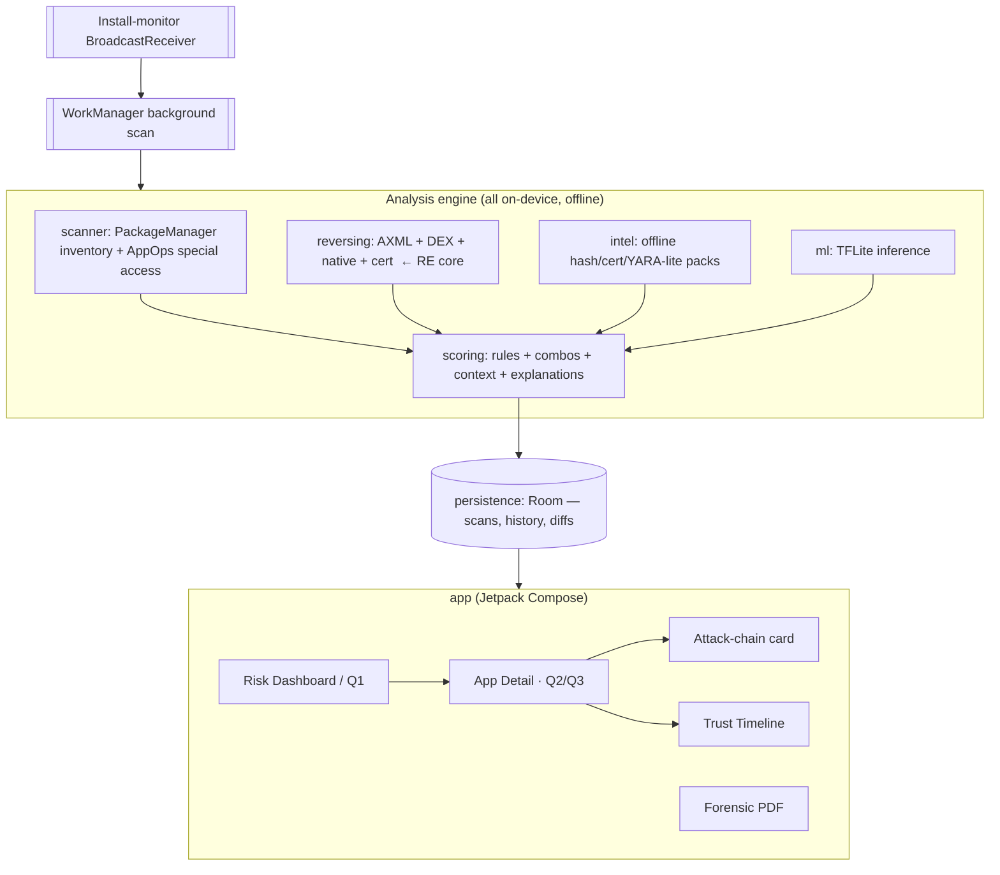

# Prahari — On-Device App Risk Auditor

> **PS-01 · Mobile Security · 6 hours · Deliverable: Working APK**
> Working title: **Prahari** (प्रहरी, "sentinel"). Alternatives: *Trinetra* ("third eye"), *APK-Kavach*, *Nirikshak*. Pick one in the first 5 minutes and move on.

---

## 0. The one-sentence pitch

> Every other team will build a **permission reader + rule score**. We build a **static reverse-engineering engine that runs entirely on the phone** — it opens each installed APK, parses the real manifest, the DEX bytecode, the native libraries and the signing certificate, and reasons about **what the code can actually do** — so every risk flag is backed by **evidence from the binary**, not just a checklist of declared permissions. And the auditor itself **declares no `INTERNET` permission**, so it is *provably* offline: it physically cannot exfiltrate anything.

That last line is the demo mic-drop for a mobile-security jury.

---

## Table of contents
1. [What "a step beyond" actually means here](#1-what-a-step-beyond-actually-means-here)
2. [The core differentiator: on-device static RE](#2-the-core-differentiator-on-device-static-reverse-engineering)
3. [Feature tiers (A–D) mapped to the PS](#3-feature-tiers-mapped-to-the-ps)
4. [System architecture](#4-system-architecture)
5. [The scoring model (also your required 1-page rubric)](#5-the-scoring-model--your-required-rubric)
6. [Tech stack & key libraries](#6-tech-stack--key-libraries)
7. [Hard technical facts & API cheat-sheet](#7-hard-technical-facts--api-cheat-sheet)
8. [Risk register & fallbacks](#8-risk-register--fallbacks)
9. [Pre-event prep (do this before hour 0)](#9-pre-event-prep-do-this-before-hour-0)
10. [In-event hour-by-hour plan](#10-in-event-hour-by-hour-plan)
11. [Demo script (3 minutes)](#11-demo-script-3-minutes)
12. [Deliverables checklist](#12-deliverables-checklist)

---

## 1. What "a step beyond" actually means here

The PS is generous but every team will hit the same baseline: read `PackageManager`, list permissions, map to 9 categories, apply a weight table, print a score. That is the **MUST-HAVE** and it is *table stakes*. Judges will see it ten times.

The gap everyone leaves open: **declared permissions lie in both directions.**
- An app can **declare** `READ_SMS` and never touch it (inherited from an ad SDK → low real risk).
- An app can declare the minimum and do its damage through **special access** (accessibility + overlay) that a permission list barely conveys.

So "a step beyond" is not *more categories* — it is a **different, higher-quality signal**: go from *"what the app says"* to *"what the app's code is actually wired to do."* That signal only comes from opening the APK and doing real (static) reverse engineering, on-device, offline. That is both the unique technical core **and** exactly the "reverse engineering" angle you wanted to add.

**Design principle — strictly offline, provably:** we ship the entire threat-intelligence layer *inside the APK* (bundled hash/cert/rule packs + a pre-trained TFLite model) and we **omit the `INTERNET` permission from the manifest entirely.** Offline isn't a mode we promise — it's a property the judges can verify in our own manifest.

---

## 2. The core differentiator: on-device static reverse engineering

For every installed app, beyond `PackageManager` metadata, we open its APK file (`ApplicationInfo.sourceDir` + `splitSourceDirs`) and statically analyse it **on the device, with no root and no network**.

### 2.1 What the RE engine extracts

| Layer | What we pull | Why it matters for risk |
|---|---|---|
| **Binary manifest (AXML)** | Real `<uses-permission>`, exported components, `intent-filter`s (`SMS_RECEIVED`, `BOOT_COMPLETED`, `NEW_OUTGOING_CALL`, accessibility `<meta-data>`), `android:debuggable`, `usesCleartextTraffic`, `allowBackup`, custom permissions, `BIND_ACCESSIBILITY_SERVICE`/`BIND_DEVICE_ADMIN`/`BIND_NOTIFICATION_LISTENER_SERVICE` service guards | Ground truth, independent of what `PackageManager` summarises; exported components + dangerous intent filters are classic trojan wiring |
| **DEX bytecode** | Enumerate referenced classes/methods/strings (method-ref level — *not* full decompilation). Build the app's **dangerous API surface**. | Tells us which permissions are actually *reachable from code* |
| **Native libs** (`lib/*/*.so`) | Presence, ABI, ELF strings, packer/protector signatures | Packed/native payloads (e.g. Virbox, Bangcle, Jiagu, SecShell) are a strong "evading analysis" signal |
| **Signing certificate** | Signer SHA-256, self-signed/debug cert, validity window, CN | Cert reuse across droppers; debug-signed production apps |
| **File hashes** | SHA-256 of `base.apk` and `classes*.dex` | Offline IOC matching (see Tier B) |

### 2.2 The "dangerous API surface" (DEX scan targets)

Flag references to, and bucket by capability:

- **SMS/OTP**: `SmsManager.sendTextMessage`, `android.provider.Telephony`, `SmsMessage`, SMS `BroadcastReceiver`
- **Accessibility abuse**: `AccessibilityService`, `onAccessibilityEvent`, `performGlobalAction`, `GLOBAL_ACTION_*`
- **Overlay**: `TYPE_APPLICATION_OVERLAY`, `WindowManager.addView`
- **Screen capture / remote control**: `MediaProjection`, `VirtualDisplay`
- **Dynamic code loading** (big red flag): `DexClassLoader`, `PathClassLoader`, `InMemoryDexClassLoader`, `System.load`
- **Reflection** (obfuscation): `java.lang.reflect.Method.invoke`, `Class.forName`
- **Process exec**: `Runtime.exec`, `ProcessBuilder`
- **Package enumeration**: `getInstalledPackages`, `queryIntentActivities`
- **Crypto + Base64** co-occurring (payload decrypt): `javax.crypto.Cipher` + `Base64`
- **Exfil sinks**: `HttpURLConnection`, `OkHttpClient`, `java.net.Socket`, `URL.openConnection`
- **Data sources**: contacts/call-log content URIs, `LocationManager`/`FusedLocationProvider`, clipboard, `KeyguardManager`

### 2.3 The three signals that nobody else will have

**(a) Declared → Granted → Used triangulation.** Three independent states per permission:
- **Declared** — in the parsed manifest
- **Granted** — runtime grant (`requestedPermissionsFlags`) or special-access grant
- **Used** — a matching dangerous API is referenced in the DEX

This produces explanations no checklist can: *"`READ_SMS` is granted **and** `SmsManager`/`SmsMessage` is referenced inside an SMS broadcast receiver → the app is actively wired to read your OTPs,"* versus *"`READ_SMS` declared but no SMS API in code → likely dead/SDK-inherited, lower risk."*

**(b) Source → Sink reachability (taint-lite).** Not FlowDroid — a pragmatic **capability graph**: if the app references a *source* (SMS/contacts/location/screen) **and** a *sink* (network/SMS-send/shared-file write), we flag a potential exfiltration path, weighted up when both land in the same class/component (coarse co-location). Rendered as a human **attack-chain narrative** (see §2.4).

**(c) Context mismatch via capability, not just label.** The PS asks to flag a torch/calculator holding SMS access. We go further: compare the app's *declared category* and *name keywords* against its *actual dangerous API surface* — a "wallpaper" app that references `SmsManager` **and** `AccessibilityService` is flagged with evidence, not a guess.

### 2.4 Attack-chain narrative (the explainability showpiece)

Turn evidence into an attacker story the judge instantly understands:

```
com.fake.wallpaper  — CRITICAL (92/100)
 If malicious, this app is wired to:
   1. READ your OTPs      ← READ_SMS granted + SmsMessage in SmsReceiver
   2. WATCH your screen    ← AccessibilityService + performGlobalAction
   3. HIDE itself          ← Device admin + overlay (blocks uninstall)
   4. SEND it all out      ← OkHttp + hardcoded host "api-sync[.]xyz"
 Installed from: sideload (not Play Store) · Signer: self-signed, 2025
```

---

## 3. Feature tiers mapped to the PS

> Ordered by **wow-per-hour**. Each tier is independently demoable, so partial completion still impresses.

### Tier C — PS baseline (MUST-HAVE; build first, make it rock-solid)
- **FR01 Inventory**: name, icon, package, version, install date, installer source, target SDK; system-app toggle.
- **FR02 Permission extraction**: declared vs granted, protection level (normal/dangerous/signature/special).
- **FR03 Categorization**: all 9 categories, per-app + device-wide summary.
- **FR04 Special-access detection**: accessibility, device admin, notification listeners, overlay, install-packages.
- **FR05 Risk score**: 0–100, four bands, ≥3 plain-language reasons for every High/Critical.
- **FR06 App detail**: "Why flagged" panel + deep-link to system settings + uninstall button.

### Tier A — The unique core (your "step beyond" + reverse engineering)
- **On-device static RE engine** (§2.1–2.2).
- **Declared→Granted→Used triangulation** (§2.3a).
- **Source→Sink attack-chain narratives** (§2.3b, §2.4).
- Covers **SHOULD-HAVE FR07 (combination rules)** and **FR08 (context mismatch)** with *code evidence*, and **stretch #12 (static manifest checks)** natively.

### Tier B — Offline intelligence (reframes the online stretch as offline)
- **B1 Offline Threat-Intel pack** (bundled, replaces online hash lookup #11): SHA-256 IOC set, bad-signer-cert set, and **YARA-style static rules** (packer class names, banking-trojan target-list arrays, C2 lookalike-domain patterns, accessibility+overlay+SMS combos). Lightweight custom rule matcher — do **not** JNI libyara in 6h.
- **B2 On-device explainable ML** (stretch #13, elevated): pre-trained **TFLite** model on **NATICUSdroid** (permissions-only, 86 features, CC BY 4.0) + optional API-category counts; shown as a *second opinion* beside the rule score, with top-3 feature attribution. **Rule score stays the source of explanations** (per PS).

### Tier D — Presentation & "what do I do now" (the judge-facing wow)
- **D1 Q1 view**: apps ranked by harm, Critical/High pinned top.
- **D2 Q2 dual-layer panel**: "grandma mode" plain reasons **+** an "analyst mode" expander showing raw evidence (manifest lines, API refs, smali-level snippet, hashes).
- **D3 Q3 one-tap actions**: revoke permission, open accessibility/overlay/device-admin settings, uninstall.
- **D4 Attack-chain card** (Compose Canvas graph).
- **D5 Trust Timeline**: permission creep across updates (**FR10 permission diff**).
- **D6 Forensic PDF report** (stretch #14, elevated): reproducible, with evidence + hashes + signer + model score.
- **FR09 Install monitoring**: `PACKAGE_ADDED/REPLACED` receiver → rescan → notify if High/Critical.

---

## 4. System architecture



**Suggested Gradle modules** (or packages if you prefer a single module for speed):
`:core-model` · `:scanner` · `:reversing` · `:intel` · `:scoring` · `:ml` · `:persistence` · `:report` · `:app`.
For a 6-hour build, **one module with clean packages is faster** than multi-module Gradle — don't fight the build system under time pressure.

**Data model (core-model):** `AppRecord`, `PermissionState{declared,granted,used,protection}`, `Category`, `SpecialAccess`, `CodeEvidence`, `IntelHit`, `RiskResult{score,band,reasons[],chain}`, `ScanSnapshot` (for timeline/diff).

---

## 5. The scoring model — your required rubric

This doubles as **Deliverable #02 (one-page scoring rubric)**. Keep it transparent and deterministic — judges reward explainability over a black box.

### 5.1 Category base weights (per *granted* permission/access)

| Category | Base weight |
|---|---|
| 01 Special access (accessibility, overlay, device admin, notif-listener, install-pkgs, usage-stats) | **25 each** (highest) |
| 02 SMS | 15 |
| 03 Contacts & call logs | 12 |
| 04 Camera & microphone | 12 |
| 05 Location | 10 |
| 06 Phone & identity | 8 |
| 07 Storage & media (esp. `MANAGE_EXTERNAL_STORAGE`) | 8 |
| 08 Background & persistence | 6 |
| 09 Network | 3 (low alone, see combos) |

### 5.2 Multipliers (the RE signal)

- **Granted** but declared-only elsewhere: a permission scores its base **only if granted**. Declared-but-not-granted → ×0.1 (noted, not scored).
- **Used in code** (matching dangerous API found in DEX): ×1.5 on that category's contribution. *This is the differentiator — risk you can prove.*
- **Installer source**: Play Store ×1.0; other store ×1.2; **sideloaded / unknown ×1.5**.
- **Target SDK very low** (`targetSdk < 23`, legacy permission model): +8 flat.

### 5.3 Combination bonuses (FR07)

- SMS-read **+** INTERNET **+** boot-persistence **+** sideloaded → **+20**
- Accessibility **+** overlay → **+25** (banking-trojan signature)
- Device admin on an app that is **not** a security/MDM tool → **+20**
- Accessibility **+** SMS **+** device admin (the Rokarolla/Herodotus pattern) → **+30**
- Dynamic code loading (`DexClassLoader`) **+** sideloaded → **+15**

### 5.4 Context mismatch (FR08)

- Utility-category/keyword app (torch, calculator, wallpaper, QR, battery) holding SMS/contacts/call-log/accessibility → **+20** and always ≥ High.

### 5.5 Intel & integrity overrides

- SHA-256 or signer-cert IOC hit → **force Critical (100)**.
- Known packer signature → **+15**.
- `debuggable=true` in a production (store) app → **+10**; `usesCleartextTraffic=true` → **+5**; exported sensitive component with no permission guard → **+10**.

### 5.6 Bands

`score = clamp(Σ contributions + bonuses, 0, 100)`

| Band | Range |
|---|---|
| Low | 0–24 |
| Medium | 25–49 |
| High | 50–74 |
| Critical | 75–100 |

**Reasons generator (FR05):** every contribution that fired emits one plain-language sentence; for High/Critical, surface the top ≥3 by weight. Example: *"Can read your text messages, and its code uses the SMS API (+22)."*

### 5.7 ML second opinion (non-authoritative)

TFLite returns `P(malicious)`. Display as a labelled gauge beside the rule score ("Model agrees: 0.87 likely harmful"). If rule=Low but ML=high, show a soft "worth a look" nudge — **never override** the rule score or the explanations.

---

## 6. Tech stack & key libraries

| Concern | Choice | Notes |
|---|---|---|
| Language / UI | **Kotlin + Jetpack Compose** | Fast, modern, demo-pretty; `LazyColumn` for inventory |
| Min / Target SDK | min 26, target 34/35 | 26+ simplifies AppOps + notif channels |
| Inventory & grants | `PackageManager`, `AppOpsManager`, `DevicePolicyManager`, `Settings.Secure` | §7 cheat-sheet |
| APK/manifest/cert parse | **Jared Rummler `apk-parser`** (Android-packaged wrapper of `net.dongliu:apk-parser`) | pure-JVM, offline; `net.dongliu:apk-parser` directly also works |
| DEX bytecode refs | **`org.smali:dexlib2`** | pure-Java, runs on Android; enumerate method/class/string refs (not full decompile) |
| Zip/native/ELF | `java.util.zip` + manual ELF header + strings scan | native libs live in the APK zip under `lib/` |
| ML | **TensorFlow Lite** (`org.tensorflow:tensorflow-lite`) | model trained **before** event on NATICUSdroid; bundle `.tflite` in `assets/` |
| Persistence | **Room** | scan history, permission diffs, timeline |
| Background | **WorkManager** + Kotlin coroutines (`Dispatchers.Default`) | scans are heavy → async with progress |
| PDF | **`android.graphics.pdf.PdfDocument`** (platform) | avoid iText licensing; Canvas → PDF, fully offline |
| Install monitor | manifest `BroadcastReceiver` on `PACKAGE_ADDED/REPLACED` (`data scheme="package"`) | package broadcasts are exempt from implicit-broadcast limits |

**Manifest stance:** declare `QUERY_ALL_PACKAGES` (PS-allowed) for visibility; **do NOT declare `INTERNET`.** Optional accessibility/notification-listener services only if you want to *demonstrate* those flows — not needed for scanning.

---

## 7. Hard technical facts & API cheat-sheet

Use these so you don't lose an hour rediscovering them. These are the robust, documented routes (with honest caveats).

- **Declared vs granted:** `packageManager.getPackageInfo(pkg, GET_PERMISSIONS)` → `requestedPermissions[]` + `requestedPermissionsFlags[]`; granted = `(flag & PackageInfo.REQUESTED_PERMISSION_GRANTED) != 0`.
- **Protection level:** `packageManager.getPermissionInfo(name, 0).protection` / `protectionFlags` → normal / dangerous / signature; "special"/appop via `PROTECTION_FLAG_APPOP`.
- **Installer source:** `getInstallSourceInfo(pkg).installingPackageName` (API 30+; fall back to `getInstallerPackageName`). `com.android.vending` = Play; `null`/other = sideload/other store.
- **Accessibility services enabled (any app):** `Settings.Secure.getString(cr, ENABLED_ACCESSIBILITY_SERVICES)` — readable, no special permission; parse the `ComponentName` list.
- **Notification listeners enabled:** `Settings.Secure.getString(cr, "enabled_notification_listeners")`.
- **Active device admins:** `DevicePolicyManager.getActiveAdmins()` → `List<ComponentName>`; map to packages.
- **Overlay / install-packages / usage-stats grant for *other* apps:** best-effort via `AppOpsManager.unsafeCheckOpNoThrow(OPSTR_SYSTEM_ALERT_WINDOW | OPSTR_REQUEST_INSTALL_PACKAGES | OPSTR_GET_USAGE_STATS, uid, pkg)`. ⚠️ Some ops/OEMs restrict cross-package queries → **fall back to "declared in manifest"** and label the state as *declared* rather than *granted* when the op isn't queryable. Don't overclaim.
- **Reading another app's APK (the RE core):** `packageManager.getApplicationInfo(pkg, 0).sourceDir` (+ `splitSourceDirs`). The base APK is generally readable without root — this is how AppManager / Exodus Privacy / Classyshark work. ⚠️ **Not guaranteed on every OEM/Android 15 build.** Wrap every open in try/catch; on failure, **degrade gracefully to `PackageManager`-only analysis** for that app and still score it (just without the "Used-in-code" signal). Decide this per app, show a small "deep scan unavailable" chip — honesty reads as rigor to a security jury.
- **Deep-link to a specific app's settings (Q3):** `Intent(ACTION_APPLICATION_DETAILS_SETTINGS, Uri.parse("package:$pkg"))`. Accessibility: `ACTION_ACCESSIBILITY_SETTINGS`. Overlay: `ACTION_MANAGE_OVERLAY_PERMISSION`. Uninstall: `Intent(ACTION_DELETE, Uri.parse("package:$pkg"))`.
- **Install broadcast:** manifest-registered receiver for `android.intent.action.PACKAGE_ADDED` / `PACKAGE_REPLACED` with `<data android:scheme="package"/>` — still delivered to manifest receivers (exempt from the Android 8+ implicit-broadcast restrictions).
- **Performance:** DEX parsing across *all* apps is the bottleneck. Cache results in Room keyed by `(package, versionCode, apkSha256)`; only re-deep-scan on change. Scan asynchronously with a visible progress bar (which is itself a great demo moment), prioritise user-installed apps, and cap the DEX string scan size per app.

---

## 8. Risk register & fallbacks

| Risk | Likelihood | Mitigation / fallback |
|---|---|---|
| `sourceDir` unreadable on judging device (OEM/Android 15) | Medium | Per-app try/catch → degrade to `PackageManager`-only scoring; show "deep scan unavailable" chip. Demo still works. |
| DEX scan too slow across 100+ apps | High | Async + cache + prioritise user apps + cap scan size; show progress. Pre-warm cache before demo. |
| `dexlib2` / apk-parser integration friction | Medium | **Do the integration spike pre-event** (§9). Have the method-ref enumeration proven on a sample APK before hour 0. |
| AppOps cross-package query blocked | Medium | Fall back to manifest-declared state, labelled honestly (§7). |
| TFLite model under-performs / overfits | Medium | It's a *second opinion* only — never gates the demo. If flaky, hide the gauge; rules carry the demo. |
| Scope creep eats the MUST-HAVE | **High** | Freeze Tier C by hour 2.5 (see §10). No differentiator work until the baseline demo runs end-to-end. |
| "No real malware" constraint | Certain | Build **benign test fixtures** that *mimic* trojan wiring (declare + reference the scary APIs, do nothing) → safe, reproducible demo on your own kit. |

---

## 9. Pre-event prep (do this before hour 0)

The PS **explicitly allows** a pre-trained ML model and uses "the organizer test kit" — so front-load everything that isn't the live build. This is where you buy your "step beyond."

1. **RE integration spike** — a throwaway Android app that opens one sample APK via `dexlib2` + apk-parser and prints manifest perms + a few method refs. *Prove it runs on a real device.* This de-risks the entire Tier A.
2. **Train the TFLite model** on NATICUSdroid (permissions-only, 86 features). Export `model.tflite` + the feature order (`features.json`). Keep it small (INT8 is fine).
3. **Curate the offline intel pack** — `assets/intel/`:
   - `ioc_hashes.txt` (publicly published IOC SHA-256 lists — hashes, not malware),
   - `bad_signers.txt`,
   - `rules.json` (YARA-lite: packer class names, target-list patterns, C2 lookalike-domain regexes, combo rules).
4. **Build 4–6 benign "evil-looking" fixture APKs** that declare + reference scary API combos (accessibility+overlay+SMS, `DexClassLoader`, etc.) but are inert. These are your safe, repeatable demo subjects.
5. **UI skeleton** — Compose navigation, dashboard list, detail screen stubs, theme. (Scaffold only; no logic — stay within scope.)
6. **The scoring rubric doc** (§5) printed to one page. It's a required deliverable *and* your scoring is just an implementation of it.
7. **Repo + CI** — a repo that builds a signed debug APK in one command, so "Working APK" is never at risk.

> ⚠️ Check the hackathon rules on how much pre-building is allowed. ML pre-training is explicitly permitted; confirm whether app pre-scaffolding is too. If not, keep prep to the *spike, model, intel pack, fixtures, and rubric* (assets/research), and build the app live.

---

## 10. In-event hour-by-hour plan

Assumes a team of 2–4 and the pre-event assets from §9. **The golden rule: a working end-to-end demo by hour 2.5, differentiators layered after, each independently shippable.**

| Time | Goal | Who |
|---|---|---|
| **0:00–0:30** | Repo wiring, module/packages, data model, drop in pre-built assets (model, intel pack, fixtures). Pick the name. | All |
| **0:30–1:30** | **Tier C spine**: inventory (`PackageManager`) → 9-category mapping → declared/granted → rule score → list UI. First numbers on screen. | Dev A (engine) + Dev B (UI) |
| **1:30–2:30** | Special-access detection (accessibility/device-admin/notif-listener/overlay/install-pkgs) + detail screen (Why-flagged, settings deep-link, uninstall). | A + B |
| **2:30** | **🔒 FREEZE baseline.** Full MUST-HAVE demo runs end-to-end. Commit + build APK #1. | All |
| **2:30–3:45** | **Tier A RE engine**: wire `dexlib2`/apk-parser from the spike; parse manifest + DEX dangerous-API surface; compute Declared→Granted→**Used**; feed the ×1.5 multiplier + combination rules. | Dev A/C |
| **3:45–4:30** | **Tier A/D**: Source→Sink attack-chain narrative + the attack-chain card; context-mismatch rule. Build APK #2. | A/C + B |
| **4:30–5:00** | **Tier B**: offline intel matching (hash/cert/rules) + TFLite second-opinion gauge. | C |
| **5:00** | **🔒 Final APK on judging device/emulator** (PS requires it by hour 5). Pre-warm the scan cache. | All |
| **5:00–5:40** | Tier D polish: Q1 ranking, dual-layer Q2 panel, Q3 actions, install-monitor receiver, PDF export, Trust Timeline. Cut whatever's flaky. | All |
| **5:40–6:00** | Rehearse the 3-min demo on *organizer-style* inputs (not your own hand-picked apps). Freeze. | All |

**Cut order if behind** (drop from the bottom up): Trust Timeline → PDF → ML gauge → attack-chain *card* (keep the text narrative) → intel pack. **Never cut** the RE "Used-in-code" signal — it *is* the project.

---

## 11. Demo script (3 minutes)

The PS says the demo runs on the **organizer test kit**, not apps you chose — so your pitch must work on *unknown* inputs. Lead with the signal, not the UI.

1. **(20s) Frame:** "Permission lists lie. We open the APK and check what the code is actually wired to do — entirely on-device. Note our manifest: **no INTERNET permission**. We can't exfiltrate even if we wanted to."
2. **(40s) Q1:** Run scan (progress bar), land on the ranked dashboard. "These three are Critical — here's why."
3. **(60s) Q2 — the differentiator:** Open the top app. Plain reasons, then expand **analyst mode**: show the manifest line, the `SmsManager` method-ref, the attack-chain narrative. "`READ_SMS` isn't just *granted* — it's *used*, in an SMS receiver, and there's a network sink. That's an OTP-exfiltration chain." Show the offline intel/ML concurring.
4. **(40s) Q3:** One tap → revoke / open accessibility settings / uninstall. Then show install-monitor firing on a fresh sideload + the PDF report.
5. **(20s) Close:** "Static reverse engineering, offline threat intel, and an explainable model — all on the phone, all offline, provably."

---

## 12. Deliverables checklist

- [ ] **Working APK** on judging device/emulator by hour 5 (build #1 at 2:30 guarantees you have *something*).
- [ ] **Scoring rubric** — §5, one page.
- [ ] **Source code** — repo link; clean README with the §0 pitch + build steps.
- [ ] **3-minute live demo** — rehearsed on organizer-style inputs (§11).

**Judge-facing one-liners to land:**
- "We score *used* permissions, not just *declared* ones."
- "Every flag has binary evidence behind it."
- "Provably offline — check our manifest."
